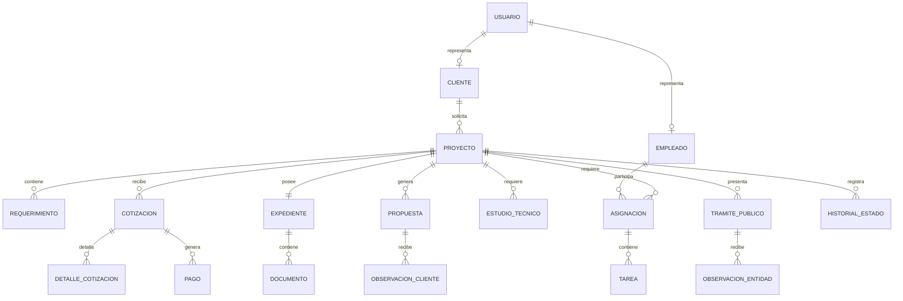

# ATELIER — Modelo de datos del proceso TO-BE

Este paquete contiene el modelo conceptual, lógico y físico para el sistema web de gestión de proyectos arquitectónicos de ATELIER.

## Arquitectura de implementación

- Frontend: React/Vite publicado en Netlify.
- Backend: Java 21 + Spring Boot publicado en Render.
- Base de datos productiva: Supabase/PostgreSQL.
- Archivos: Cloudinary; la base de datos conserva la URL y el `public_id`.
- Versión académica adicional: script físico equivalente para SQL Server.

## 1. Modelo conceptual

### Entidades principales

- Usuario: cuenta de acceso con un rol.
- Cliente: persona o empresa que solicita el proyecto.
- Empleado: encargado, arquitecto, especialista o administrador.
- Proyecto: unidad central del proceso.
- Requerimiento: necesidad funcional o técnica del cliente.
- Cotización: propuesta económica versionada.
- Pago: comprobante y validación de un adelanto o adicional.
- Expediente: contenedor digital del proyecto.
- Documento: archivo almacenado en Cloudinary.
- Especialidad: arquitectura, estructuras, electricidad, sanitaria u otra.
- Asignación y tarea: planificación del trabajo de los especialistas.
- Estudio técnico: topografía, mecánica de suelos u otro análisis.
- Propuesta: versión del anteproyecto o diseño.
- Observación del cliente: solicitud de corrección sobre una propuesta.
- Trámite público: expediente presentado ante una entidad pública.
- Observación de entidad: requerimiento emitido por la municipalidad u otra entidad.
- Notificación: aviso interno a un usuario.
- Historial y auditoría: trazabilidad de estados y acciones.

### Relaciones conceptuales

## 2. Modelo lógico

| Tabla | Clave primaria | Claves foráneas principales | Finalidad |
|---|---|---|---|
| roles | id_rol | — | Catálogo de perfiles |
| usuarios | id_usuario | id_rol | Credenciales y estado de acceso |
| clientes | id_cliente | id_usuario | Datos del solicitante |
| empleados | id_empleado | id_usuario | Personal interno y externo |
| proyectos | id_proyecto | id_cliente, id_encargado | Control central del proyecto |
| requerimientos | id_requerimiento | id_proyecto | Necesidades registradas |
| cotizaciones | id_cotizacion | id_proyecto, creada_por | Versiones económicas |
| detalle_cotizacion | id_detalle | id_cotizacion | Servicios, cantidades y precios |
| pagos | id_pago | id_cotizacion, validado_por | Comprobantes y validación |
| expedientes | id_expediente | id_proyecto | Expediente digital único |
| documentos | id_documento | id_expediente, subido_por | Metadatos de Cloudinary |
| especialidades | id_especialidad | — | Catálogo técnico |
| asignaciones | id_asignacion | id_proyecto, id_empleado, id_especialidad | Participación profesional |
| tareas | id_tarea | id_asignacion | Trabajo planificado |
| estudios_tecnicos | id_estudio | id_proyecto, responsable | Estudios requeridos |
| propuestas | id_propuesta | id_proyecto, creada_por | Versiones del diseño |
| observaciones_cliente | id_observacion_cliente | id_propuesta, id_cliente | Correcciones del cliente |
| tramites_publicos | id_tramite | id_proyecto, responsable | Seguimiento municipal |
| observaciones_entidad | id_observacion_entidad | id_tramite | Subsanaciones oficiales |
| notificaciones | id_notificacion | id_usuario, id_proyecto | Avisos del sistema |
| historial_estados | id_historial | id_proyecto, cambiado_por | Cambios de estado |
| auditoria | id_auditoria | id_usuario | Registro técnico de acciones |

### Reglas de negocio principales

1. Cada proyecto pertenece a un solo cliente y tiene un código único.
2. Un proyecto puede tener varias cotizaciones, pero solo una versión aceptada vigente.
3. Cada pago se registra primero como PENDIENTE y debe ser validado o rechazado por un empleado autorizado.
4. Cada proyecto tiene un expediente digital; los archivos físicos permanecen en Cloudinary.
5. Una propuesta puede recibir observaciones y generar nuevas versiones.
6. Más de dos rondas de cambio pueden originar una cotización adicional.
7. Los trámites públicos y sus observaciones se registran manualmente porque la entidad pública es externa.
8. Todo cambio de estado importante debe insertarse en `historial_estados`.

## 3. Modelo físico

- `01_supabase_postgresql.sql`: estructura ejecutable en Supabase.
- `02_datos_demo_supabase.sql`: datos ficticios para demostrar el recorrido completo.
- `03_sqlserver.sql`: versión física académica para Microsoft SQL Server.
- `ATELIER_Modelo_Datos_StarUML.mdj`: diagrama de clases editable en StarUML.

## Orden de ejecución en Supabase

1. Abrir SQL Editor.
2. Ejecutar `01_supabase_postgresql.sql`.
3. Ejecutar `02_datos_demo_supabase.sql` si se requieren datos de demostración.
4. Conectar el backend Java usando `SUPABASE_DB_URL`, `SUPABASE_DB_USER` y `SUPABASE_DB_PASSWORD` como variables de entorno.

## Elementos simulados

- La confirmación bancaria se simula mediante la validación manual de `pagos`.
- Las respuestas municipales se simulan registrando estados y observaciones en `tramites_publicos` y `observaciones_entidad`.
- Las notificaciones quedan dentro del sistema; el envío real de correo o WhatsApp puede añadirse posteriormente.

Los clientes, proyectos, pagos, tareas y documentos sí se almacenan realmente en Supabase.
